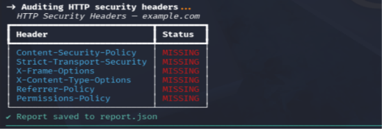
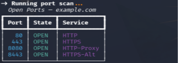
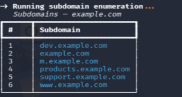

# Recon CLI

Asynchronous reconnaissance toolkit for authorized security assessments. It enumerates subdomains from Certificate Transparency logs, runs a TCP connect scan, and audits HTTP security headers. Results are shown in the terminal and can be saved as JSON or a self-contained HTML report.

Use it only on systems you own or have explicit permission to test.


## Features

- **Subdomain enumeration** queries [crt.sh](https://crt.sh/) and keeps only names that belong to the domain you asked for. Wildcards, email addresses, and lookalike suffixes are dropped.
- **TCP connect scanner** checks ports with `asyncio`, a connection semaphore, and a per-socket timeout. It does not need raw sockets or administrator rights, so it runs on Windows and Linux.
- **HTTP header audit** fetches the final response with `aiohttp` and grades common security headers, including weak values such as a very short HSTS `max-age`.
- **Isolated modules.** Each task has its own timeout and error list. One failure does not cancel the others.
- **Terminal UI** built with Rich: a run banner, live progress, color status tables, and a summary.
- **Reports** in JSON (schema version 2) and a single interactive HTML file that works offline.

## Requirements

- Python 3.10 or newer
- Network access to the target you are authorized to assess
- Outbound HTTPS to `crt.sh` when you use subdomain enumeration

## Installation

```bash
git clone https://github.com/umidguluzada/recon-cli.git
cd recon-cli
python -m venv .venv
```

Windows (PowerShell):

```powershell
.\.venv\Scripts\Activate.ps1
python -m pip install -r requirements.txt
```

macOS and Linux:

```bash
source .venv/bin/activate
python -m pip install -r requirements.txt
```

## Usage

```bash
python main.py <target> [options]
```

`target` may be a domain (`example.com`), an IP address (`203.0.113.10`), or an origin (`https://example.com:8443/health`). Credentials, query strings, and fragments are rejected.

Pass the registrable domain (`example.com`) when you want subdomain enumeration. If the target is an IP address, subdomain enumeration is skipped and the rest of the run continues.

### Options

| Flag | Description |
|------|-------------|
| `--subdomains` | Enumerate names from crt.sh |
| `--ports` | TCP connect scan of the default common ports |
| `--headers` | Audit HTTP security headers |
| `--all` | Run every module |
| `--port-list PORTS` | Scan these ports or ranges, for example `22,80,443,8000-8080`. Implies a port scan |
| `--top 100` | Scan the curated set of 100 common TCP ports. Implies a port scan |
| `-o, --output FILE` | Write JSON. Use `-` to write JSON to stdout |
| `--html FILE` | Write a self-contained HTML report |
| `--timeout SECONDS` | Per-port connection timeout (default `1.5`, max `30`) |
| `--http-timeout SECONDS` | Timeout for crt.sh and the header request (default `20`, max `120`) |
| `--module-timeout SECONDS` | Overall timeout for each module (default `180`, max `3600`) |
| `--concurrency N` | Maximum in-flight TCP connections (default `100`, max `1000`) |
| `--retries N` | Attempts after a transient crt.sh failure (default `3`) |
| `--insecure` | Skip TLS verification for the header audit |
| `-v, --verbose` | Show retry and DNS messages |
| `-q, --quiet` | Hide the banner and finding tables. The summary and report files are still written |
| `--version` | Print the version |

The default port profile is unchanged from earlier releases: 21, 22, 23, 25, 53, 80, 110, 143, 443, 3306, 3389, 8080, and 8443. If the target URL includes a port, that port is added to the scan.

A single scan accepts at most 2048 ports. `--port-list` and `--top` cannot be combined.

### Examples

Run every module and write both reports:

```bash
python main.py example.com --all --output report.json --html report.html
```

Enumerate subdomains only:

```bash
python main.py example.com --subdomains
```

Scan with a longer timeout and more sockets:

```bash
python main.py example.com --ports --timeout 2 --concurrency 200
```

Scan the 100-port profile:

```bash
python main.py example.com --top 100
```

Scan an explicit list:

```bash
python main.py example.com --port-list 22,80,443,8000-8080
```

Audit headers for a specific origin, including a lab certificate:

```bash
python main.py https://lab.internal:8443 --headers --insecure
```

Pipe JSON to another tool. Progress and tables stay on stderr:

```bash
python main.py example.com --headers --output - > headers.json
```

### Exit codes

| Code | Meaning |
|------|---------|
| 0 | Every selected module finished or was skipped, even if it found nothing |
| 1 | A module failed, or a report file could not be written |
| 2 | The command line or target was invalid |
| 130 | The scan was interrupted |

## Reports

### Terminal

The CLI prints a banner, one progress line per module, a table of findings, and a summary. Tables cap the on-screen subdomain list at 200 rows. The JSON and HTML reports keep the full set.

### JSON

`--output` writes schema version 2:

```json
{
  "tool": "recon-cli",
  "version": "2.0.0",
  "schema_version": 2,
  "target": {"host": "example.com", "url": "https://example.com"},
  "summary": {
    "subdomains": 1,
    "open_ports": 1,
    "header_issues": 1,
    "highest_severity": "medium"
  },
  "modules": {
    "subdomains": {"status": "success", "findings": ["www.example.com"]},
    "ports": {"status": "success", "findings": [{"port": 443, "state": "open"}]},
    "headers": {"status": "success", "findings": []}
  }
}
```

Header findings use `present`, `missing`, `weak`, or `not_applicable`. Severity is `info`, `low`, `medium`, or `high`. `header_issues` counts missing or weak headers at low severity or above. Informational items, such as a `Server` banner, stay in the findings list and do not increase that count.

This schema replaces the flat `report.json` written by 1.x.

### HTML

`--html report.html` writes one file with embedded CSS and JavaScript. Open it in a browser. You can filter subdomains and ports, show only header issues, sort columns, and expand the raw JSON. The page does not load remote assets.

## Architecture

`main.py` is the composition root. It validates the target, opens one `aiohttp` client, and schedules the selected modules on a single event loop. Modules run at the same time. Each one is wrapped in `asyncio.wait_for`, so a hung crt.sh request cannot block the port scan forever.

```
main.py
├── parse target, ports, and limits
├── aiohttp.ClientSession  (subdomains + headers)
└── asyncio.gather
    ├── SubdomainEnumerator   crt.sh, retries, name validation
    ├── PortScanner           DNS once, then TCP connect + semaphore
    └── HTTPAuditor           GET, up to 5 redirects, header grading
         │
         └── Reporter
             ├── Rich tables and summary
             ├── report.json
             └── report.html
```

| Path | Role |
|------|------|
| `main.py` | Argument parsing and the async run |
| `modules/base.py` | Shared timeout, error capture, and `ModuleResult` |
| `modules/subdomain.py` | Passive Certificate Transparency lookup |
| `modules/port_scanner.py` | Async TCP connect scan and port profiles |
| `modules/http_audit.py` | Header fetch and pure grading function |
| `utils/validators.py` | Host, URL, and port-list checks |
| `utils/reporter.py` | Terminal rendering and file export |
| `utils/html_report.py` | Offline HTML report |
| `utils/console.py` | Log buffer used while progress bars are active |

Network work stays inside the modules. Grading a header set and extracting subdomains from a crt.sh payload are pure functions, so they can be tested without sending packets.

Proxy environment variables are not applied. The client uses a fixed User-Agent, `recon-cli/<version>`.

## Project layout

```
recon-cli/
├── main.py
├── requirements.txt
├── modules/
│   ├── base.py
│   ├── subdomain.py
│   ├── port_scanner.py
│   └── http_audit.py
├── utils/
│   ├── validators.py
│   ├── reporter.py
│   ├── html_report.py
│   └── console.py
└── tests/
```

## Development

```bash
python -m unittest discover -s tests -t .
```

The tests cover target parsing, crt.sh payload filtering, header grades, a local TCP listener, a local HTTP audit, report escaping, and one full CLI run against `127.0.0.1`. They do not contact external hosts.

## Screenshots





## Disclaimer

This tool is for systems you own or are explicitly authorized to test. Scanning systems without permission may be illegal. The authors and contributors accept no liability for misuse or for damage caused by a scan.

Confirm findings before you act on them. A missing header is a hardening signal, not proof that an application can be compromised. An open port only means a TCP handshake succeeded.

## License

MIT. See [LICENSE](LICENSE).

## Contributing

Pull requests are welcome. For a change in scan behavior or report schema, open an issue first.
